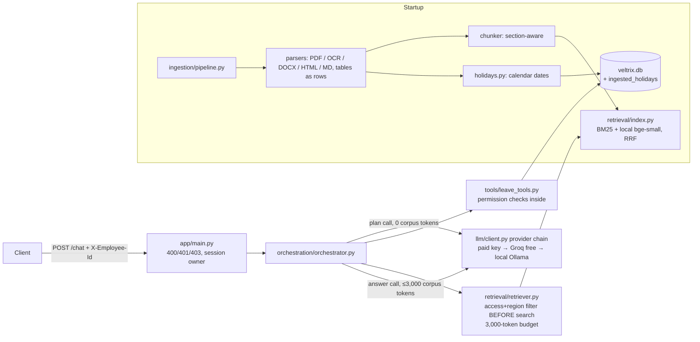

# Veltrix PeopleOps Assistant

An HR assistant API for Veltrix Systems. It answers policy questions from the HR corpus with citations, applies the
Section 5 eligibility and precedence rules, and reads and changes leave data through five permission-checked tools.


---

## 🚀 Deploy on Render (free tier)

This repo ships a `render.yaml` Blueprint that provisions:
- **Web Service** — Docker image (uvicorn + FastAPI)
- **PostgreSQL** — Render free-tier database (auto-wired as `DATABASE_URL`)

### Steps

```bash
# 1. Push this branch to GitHub / GitLab
git push origin feature/postgres-render

# 2. Open https://dashboard.render.com → New → Blueprint → connect your repo
#    Render detects render.yaml automatically.

# 3. Set your LLM key in the Render dashboard (GROQ_API_KEY is pre-selected; free tier)

# 4. After the first successful deploy, open the Render Shell for the web service:
psql $DATABASE_URL -f scripts/schema.sql        # create tables
python scripts/migrate_sqlite_to_pg.py          # seed data from the SQLite snapshot

# 5. Hit the health endpoint
curl https://<your-app>.onrender.com/health     # {"status":"ok"}
```

> **Note:** Render free Postgres has a **90-day limit** — upgrade to Starter ($7/mo) to keep it permanently.

---

## Quick start (local / Docker)

```bash
cp .env.example .env              # set LLM_PROVIDER and its key (openai | anthropic | gemini)
# put the data in ./data:  data/corpus/  data/manifest.json  data/veltrix.db
docker compose up --build
curl localhost:8000/health        # {"status":"ok"} once ingestion has finished
```

```bash
curl -s localhost:8000/chat -H "Content-Type: application/json" -H "X-Employee-Id: E1001" \
     -d '{"session_id":"demo-1","message":"How many sick days do I get?"}'
```

## Running without a paid API key (free / open-source)

The LLM client builds a **provider chain** at startup and uses the first one that is configured:

1. `LLM_PROVIDER`, if its key is set
2. any other paid key that is set (OpenAI, Anthropic, Gemini)
3. **Groq** (`GROQ_API_KEY`): a free tier serving open-weight models (default `openai/gpt-oss-120b`)
4. **Ollama** (`OLLAMA_BASE_URL` reachable): a fully local open-source model (default `qwen2.5:3b`), no key needed

If a call fails, the next provider in the chain is tried (`LLM_MAX_ATTEMPTS`, default 2). The chain is logged at
startup (`llm_chain`), and every `llm_call` log line shows the provider, model and `corpus_tokens`.

**Embeddings never need a key.** They run locally on CPU with the open-source `BAAI/bge-small-en-v1.5` model
(fastembed), which is baked into the image. If the model can't load, retrieval falls back to BM25 only.

| Option | Setup | Speed |
|---|---|---|
| Groq (recommended for testing) | Put `GROQ_API_KEY=...` in `.env`, then `docker compose up --build` | Fast; free-tier rate limits apply |
| Ollama in Docker | `docker compose --profile local-llm up --build`. The model is downloaded on first start (watch for the `ollama_ready` log line) | CPU only, so slow on small machines |
| Ollama installed on your PC | `ollama pull qwen2.5:3b`, then set `OLLAMA_BASE_URL=http://host.docker.internal:11434` | Depends on your hardware |

Check which provider will be used: `docker compose run --rm app python scripts/check_llm.py`

## Test UI

Open **http://localhost:8000** in a browser for a simple chat page.
Enter an employee ID (for example E2004 for an employee,
E2002 for a manager, E1001 for HR) and ask questions. Each answer
shows its route, citations and tool calls. Type `yes` to confirm
a leave booking. The page is a developer aid only; the API
contract is unchanged.

## Running without Docker (Windows)

    python -m venv .venv
    .\.venv\Scripts\Activate.ps1
    pip install -r requirements.txt
    copy .env.example .env      # add GROQ_API_KEY or a paid key
    uvicorn app.main:app --port 8000

`.env` is loaded automatically when running outside Docker.
For the scanned PDF, install Tesseract OCR
(`winget install -e --id UB-Mannheim.TesseractOCR`). The code
finds it on PATH, via `TESSERACT_CMD`, or in the default
Windows install folder.

## Tests

Tests run offline, with a synthetic corpus and a fake LLM.

```bash
make test                                  # or: python -m pytest -q
docker compose run --rm app make test      # inside the image (includes Tesseract for the OCR test)
```

Helper scripts:

| Script | Purpose |
|---|---|
| `scripts/inspect_ingestion.py` | Chunks, locators and extracted holidays per document |
| `scripts/debug_retrieval.py EMP "question"` | Passages and precedence ranking sent to the LLM |
| `scripts/check_llm.py` | Which LLM provider is active, plus a test call |
| `scripts/groq_test.py` | Groq key check and the models it can use |
## Architecture



The code is split into **ingestion** (`app/ingestion`), **retrieval** (`app/retrieval`), **orchestration**
(`app/orchestration`, `app/llm`), **tools** (`app/tools`) and **data access** (`app/db.py`).

## Live monitor (demo feature)

The test page at http://localhost:8000 has a side panel that shows,
for each message: the planner's decision, the passages retrieved and
sent to the LLM with their token counts against the 3,000 limit, the
precedence ranking, tool calls, and input/output tokens and time for
every LLM call. It reads GET /debug/trace/{request_id}, which returns
a trace only to the employee who sent the request. Traces are kept
in memory (last 100) and never written to logs. Set TRACE_ENABLED=0
to turn it off. /chat and /health are unchanged.

## Assumptions and workings

1. **Reference date.** If the question names a past year, the reference date is 31 December of that year. A future
   date is never used as the reference date; future policies appear only as "upcoming changes".
2. **Holiday calendars.** For each year, the applicable calendar is chosen with the Section 5 rules, using
   calendars that actually list dates in that year. Holidays marked optional, restricted or floating are not days
   off. If two calendars tie, their dates are combined.
3. **Manager visibility** means direct reports only. HR can see any single employee but cannot use
   `get_team_leave`, which is "managers only".
4. **Permission refusals** use route `refuse` with empty `tool_calls`, as the route table requires. The message is
   the same whether the employee exists or not.
5. **Rule violations** in `apply_leave`/`cancel_leave` use route `tool`, with `status: "error"` and the specific
   reason.
6. **Clear confirmation** is a short message matching a fixed list (yes / confirm / go ahead / ok / proceed …).
   Any other message discards the proposal; if it changes the details, a new proposal is made.
7. **Locators.** The locator is the nearest heading, or `p. N` for PDF text with no heading above it (`p. 1` for
   other formats).
8. **Personal data.** Tool data sent to the LLM never includes phone numbers or emails. Names are included only
   for `get_team_leave` results.
9. **Sessions** are kept in memory with one worker.
10. **The free LLM fallback** is for development only. The service is designed for and evaluated with a paid
    provider. Small local models follow the JSON format and rules less reliably, and on CPU they may exceed the
    30-second limit.
11. **"Follows local law".** Where a policy only says a topic
    follows local law and no regional document gives details
    (for example jury duty in India or Germany), the assistant
    says so and refers the user to HR. It does not invent an
    entitlement.
12. **Shared mailboxes.** All email addresses in answers are
    masked, including team mailboxes such as the HR address in
    the hybrid work memo. This is stricter than Section 7.4
    requires, but safe.
13. **Scanned memo locators.** The scanned memo has no numbered
    headings, so its citations use the nearest OCR heading
    (for example "INTERNAL MEMORANDUM").
14. **Today's date.** Set with `APP_TODAY` for reproducible tests;
    if empty, the system date is used.

## Sample queries tested

| As | Message | Result |
|---|---|---|
| E2004 (IN employee) | How many sick days do I get? | rag: 12 days (POL-LEAVE-GLOBAL-V2; FAQ/wiki value of 10 ignored) |
| E4004 (DE employee) | How many sick days do I get? | rag: 30 days (ADD-LEAVE-DE wins on scope) |
| E3004 (US employee) | Do I get paid leave for jury duty? | rag: 10 days (ADD-LEAVE-US) |
| E2004 (IN employee) | Do I get jury duty leave? | rag: follows local law, contact HR |
| E2004 / E3004 | How many days a week can I work from home? | rag: 3 days (MEMO-HYBRID-2026) |
| E4004 (DE employee) | How many days a week can I work from home? | rag: 2 days (memo not applicable) |
| E2004 | What are the compensation bands for 2026? | no_answer (HR-only document never retrieved) |
| E2004 | What is my leave balance? | tool |
| E2004 | Book annual leave 2026-11-02 to 2026-11-04 → "yes" | tool: pending_confirmation → success |
| E2002 (manager) | Who in my team is off next week? | tool: direct reports only |
| E2004 | What is the capital of France? | refuse |

## Known limitations

- Deciding whether two passages describe "the same rule" is done by the LLM. Code computes eligibility and the
  precedence ranking and passes them in.
- PDF table detection relies on PyMuPDF `find_tables`. Unusual layouts fall back to line-by-line text.
- Name lookup has no fuzzy matching.
- Sessions are held in memory.
- If every LLM provider fails, a keyword planner handles only simple balance and request questions.
- A local Ollama model on a CPU-only laptop can be slow (two LLM calls per message).
- Answer wording can vary slightly between runs on the free Groq
  model; the precedence rules and citations stay the same.
- Groq's free tier has rate limits; rapid testing can return
  temporary errors.

## Evaluation
| `scripts/run_eval.py --retrieval` | Recall, MRR, leaks and tokens for retrieval (no LLM) |
| `scripts/run_eval.py --e2e` | Routes, citations, facts, leaks and latency against the running service |